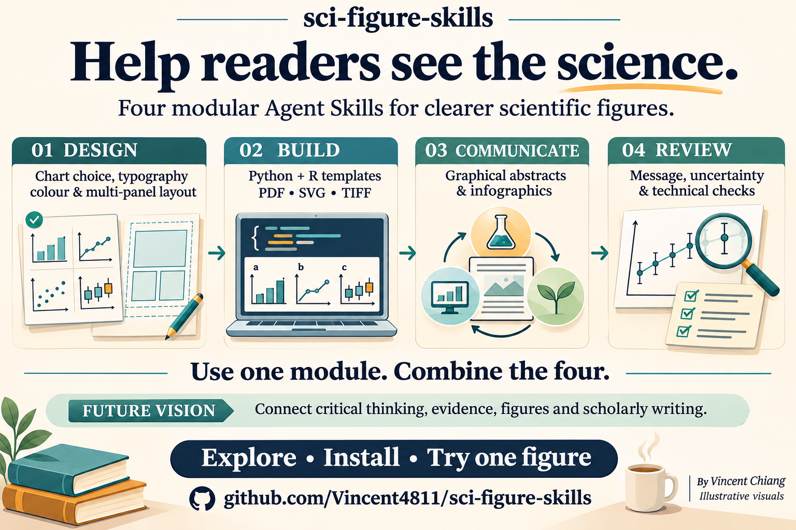

# sci-figure-skills



Agent Skills for designing scientific figures, graphical abstracts and infographics — with special focus on **typography** and **multi-panel (a/b/c) layout**, plus runnable Python/R templates.

| Skill | Use it for |
|---|---|
| `skills/figure-design-core` | Design rules: Fujii's 5 tactics, chart chooser, colour, typography, multi-panel layout, statistical honesty, verified journal specs (Nature, Cell, PLOS, Elsevier) |
| `skills/data-to-figure` | matplotlib & ggplot2/patchwork templates: theme, auto panel labels, exact mm export to PDF/SVG/TIFF |
| `skills/graphical-abstract-and-infographic` | Message → layout → icons → arrows → text → colour workflow; GA vs vertical infographic specs; tool notes |
| `skills/figure-review-rubric` | 1-second test, reverse feedback, 32-point rubric for self-review or grading |

Teaching material (Traditional Chinese): `docs/teaching-zh-TW/`.

## Publisher-first journal specs
Journal figure rules live in `skills/figure-design-core/references/publishers/`, one file per publisher: Springer Nature, Cell Press, PLOS, Elsevier, Wiley, Taylor & Francis, Dove Press, SAGE, Oxford University Press, Cambridge University Press, Frontiers, MDPI, IEEE, ACS, RSC, AAAS/Science and ASM (DOAJ is a directory, not a publisher). `journal-specs.md` is the index and overview table.

Each file has:
1. **Publisher base rules**: font, size, widths, max dimensions, formats, resolution, colour mode, panel labels.
2. **Journal exceptions**: only the journals that differ, e.g. Nature Communications uses 88/180 mm, while the Nature base is 89/183 mm.

Each rule cites a source and is marked ✅ verified or ⚠️ check before use. To resolve a journal, apply the base rules, then the exception, then the journal's own current guide.

**Add a publisher:** copy `publishers/_TEMPLATE.md` to `publishers/<publisher>.md`, fill in the base table with sources, and add a row to the index in `journal-specs.md`.

**Add a journal exception** to the publisher file:
```markdown
### Food Microbiology
| Item | Differs how | Source / status |
|---|---|---|
| Column widths | ... | ✅ [FM-GFA] https://... (checked YYYY-MM-DD) |
```
List only the items that differ from the base. Then update the "Journals with exceptions" column in the index.

## Install
Each folder under `skills/` is a self-contained skill (`SKILL.md` with YAML frontmatter `name` + `description`).
- **Claude Code / Agent-Skills-compatible agents**: copy or symlink folders into `~/.claude/skills/` (user) or `.claude/skills/` (project).
- **Other agents**: point the agent's skill directory at `skills/`, or paste `SKILL.md` into a system prompt.

Python templates:
```bash
python -m venv .venv && .venv/bin/pip install matplotlib numpy pandas
cd skills/data-to-figure/scripts && ../../../.venv/bin/python fig_template.py --journal nature
```
R: `install.packages(c("ggplot2","patchwork","svglite"))` then `Rscript fig_template.R`  
The R template preflights required packages (ggplot2, patchwork, svglite) before plotting to avoid partial outputs.

## Example data
All example data are **simulated** food-microbiology values (growth curves, D-value survival, CFU counts) produced by `simulate_data.py`. They are not experimental results.

## Future direction: a connected academic toolkit

The longer-term vision is to connect complementary Skills for critical thinking, evidence appraisal, scientific figures and scholarly writing. The goal is to help researchers carry a clear, traceable argument from question to communication. Cross-Skill orchestration is a future direction.

## Sources & copyright
Content paraphrases and cites the sources listed in each skill's `references/`. No figures or long passages are reproduced. Midway (2020) is CC BY-NC-ND, Healy (2018) is all rights reserved, Amoah-Oppong (2025) is CC BY-NC, and Jambor & Bornhäuser (2024) is CC BY. See `LICENSE-NOTES.md`.

## Licence
- Code (`*.py`, `*.R`, `*.sh`): **MIT**, see `LICENSE` (© 2026 Vincent Chiang).
- Text, skills documentation and teaching material (`SKILL.md`, `references/`, `templates/*.md`, `docs/`): **CC BY 4.0**, see `LICENSE-CC-BY-4.0`. Attribute as: "sci-figure-skills by Vincent Chiang, CC BY 4.0".
- Third-party works cited remain under their own licences.
